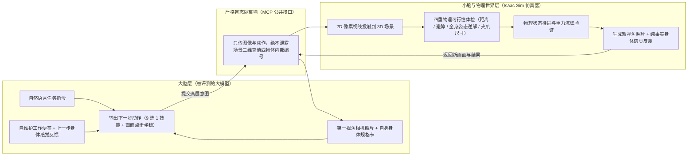
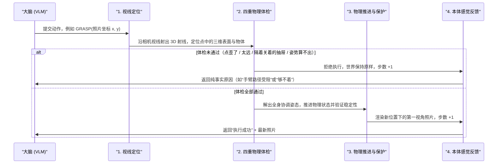

# FindingBench 项目全景导读：当机器人有了可靠的“小脑”，“大脑”还会卡在哪里？

这份文档面向团队合作者，尽量用大白话把 **我们为什么要做这件事**、**整个系统在上层是怎么跑起来的**，以及 **几个最关键也最反直觉的设计巧思** 讲清楚，不堆砌底层代码和公式。

---

## 一、 我们的核心目的：拆开“大小脑”，做一次干净的归因实验

在真实的家庭环境里让机器人“去客厅找把餐刀放到白色厨房台面上”，它需要同时做好两件完全不同的事：
1. **大脑（高层认知与规划）**：看懂指令和眼前的画面，猜餐刀可能藏在哪个抽屉或遮挡物后面，记住自己已经翻过哪里、手里正拿着什么，决定下一步该往哪走、先开哪个抽屉、把东西放在哪块空地上。
2. **小脑（底层运动与控制）**：稳稳地迈步绕开家具、弯腰下蹲、协调腰部和手臂关节伸到目标位置、合拢手指把东西抓稳、拉开或关上抽屉。

过去很多端到端具身评测最大的痛点是 **“大小脑糊在一起”**：任务失败了，你根本分不清到底是模型“没脑子”（不知道去翻抽屉），还是底层控制“手滑了”（脚底打滑、手指夹歪、轨迹抖动把杯子碰飞）。

> [!IMPORTANT]
> **我们的核心科学假设**
> **哪怕机器人的“小脑”已经做得非常可靠（能稳健走路、避障、全身协调伸手、精准开合抽屉与抓放物品），现有的多模态大模型在充当机器人“大脑”时，面对真实杂乱的家庭翻找任务，依然会出现系统性的认知失败。**

为了严格验证这个假设，我们构建了 **FindingBench**：
- **做法**：给一台真实规格的双足人形机器人（宇树 Unitree G1，配二指平行夹爪）装上一套高度可靠的“标准小脑”，并用一道严格的“盲态隔离墙”把大模型“大脑”隔开。
- **规模**：在 **50 套不同布局、摆满三四十件日常杂物的真实感家庭房间** 中构建了 **1,000 个翻找与递送任务**（目标可能藏在闭合抽屉里、冰箱门里，或被其他杂物挡在后面）。
- **结论目标**：既然小脑不会掉链子，那么实验中暴露出的每一次失败，都能被 **100% 干净地归因到“大脑”的认知短板上**，从而让我们提炼出当前大模型作为具身大脑的几大典型失败范式。

---

## 二、 上层实现全景：怎么把“大脑”和“小脑”彻底隔开？

整个系统在运行时分成左右两个完全隔离的世界，中间只留一个极简的“感官与指令窗口”：

### 大脑能看到什么？（和真人进屋完全一样，没有任何“透视挂”）
- **一句自然日常的英文指令**：例如 *“去客厅找一下那栋红顶小玩具屋，把它放到带空气炸锅的白色厨房台面上”*。
- **机器人头部的第一视角照片**：就像机器人自己眼睛看到的画面（如果调用了 `CHECK` 凑近端详技能，还会附带一张手里/眼前物品的四周特写卡片）。
- **一张固定的“身体说明书”**：告诉大脑“你身高约 1.32 米，有效伸手半径约 0.86 米，二指夹爪最大能张开约 8.8 厘米”——不靠猜，但得自己结合画面判断远近。
- **自己写的“随身便签”**：每一步大模型可以写一两百字的备忘录（记下翻过哪几个盒子、门关没关），系统下一步原样递回给它，绝不替它记账。

### 大脑能干什么？（只有 9 个高层技能）
大脑不需要输出关节角度或电机力矩，只需要每一步从 **9 个日常动作** 里选一个：
- **看与走**：`VIEW`（转头/低头/放大看细节）、`TURN`（原地左转/右转/转身）、`MOVE_TO`（在画面里点一块地板走过去，或点一件家具走到它跟前）。
- **翻与验**：`OPEN`（点抽屉或冰箱门把它打开）、`CLOSE`（点开着的抽屉或门把它关上）、`CHECK`（点一个可疑物品凑近看清四面包装）。
- **拿与放**：`GRASP`（点目标物品抓起来）、`PLACE`（点一块平坦台面把手里东西放下）。
- **交卷**：`REPORT_DONE`（认为全部找齐放好且现场收拾妥当后，宣布任务完成）。

---

## 三、 每一步执行的内部机制：大脑点一下画面，小脑在背后做了什么？

这是理解整个系统最核心的一环：**“小脑很强，但它绝不替大脑动脑筋。”** 当大脑在照片上点了一个位置 `(x, y)` 并下达技能（比如 `GRASP` 抓取）时，小脑按以下 4 步严格流水线运转：

具体来说，小脑的 **四重体检与落地逻辑** 如下：
1. **第一关：状态与目标对不对？**
   - 如果手里已经抓着东西还下令 `GRASP`，直接拒绝（提示“夹爪已占用”）；如果点 `OPEN` 却点在了茶几固定的木头腿上而不是抽屉面板上，直接拒绝（提示“点击处没有可开合结构”）。
2. **第二关：身体够不够得着、夹不夹得住？**
   - 检查目标离机器人站立中心的水平距离是否在手臂工作半径内，检查物品最窄处是否放得进二指夹爪。如果机器人隔着两米远就想伸手抓，直接拒绝（提示“超出可达范围”）。
3. **第三关：路径通不通、全身姿态算不算得出？**
   - **走路（`MOVE_TO`）**：小脑会按宇树 G1 的真实身体宽度（半径 `22 cm`），在房间多个高度层发射激光束做网格寻路（A\* 算法）。只要有安全通道就能自动绕过去站好；如果目标点被家具堵死，则拒绝移动。
   - **伸手（`GRASP` / `PLACE`）**：小脑会沿着手掌到目标的轨迹做三维碰撞扫描，并用 GPU 运动学求解器（cuRobo）同时协调 **3 个腰部关节 + 7 个手臂关节** 解算真实人形姿态。**注意一个典型场景**：如果玩具在半关着的抽屉里，模型没开抽屉就直接点缝隙里的玩具，手臂碰撞扫描会撞上抽屉挡板并报错 *“手臂路径受阻”*——小脑不会帮它自动开抽屉，大脑必须自己反应过来“哦，我得先调 `OPEN`”！
4. **第四关（反直觉保护机制）：重力沉降测试与“失败自动回滚”**
   - 当大脑执行 `PLACE` 把物品放到桌面上时，小脑松手后会让物理引擎真实运行约 1 秒钟的重力与碰撞模拟，看物品能不能稳稳停在目标台面上。
   - **为什么要做“自动回滚”？** 假设大脑点在了桌子最边缘或者斜面上，物品一松手掉到了地上甚至滚进了沙发底——如果不做处理，后面就变成了测“怎么去沙发底下捞东西”的偶然事故。所以在我们的机制里，一旦沉降检测发现物品滑落或没停稳，小脑会 **瞬间把时间倒回松手前，让物品重新回到夹爪里**，同时扣除 1 步并告诉大脑 *“放置位置不稳”*，让大脑重新选一块平整空地再放。

---

## 四、 三个最反直觉、但最关键的技术设计展开

除了常规流程，下面这三个地方如果只看表面很容易让人困惑，这里专门把背后的设计逻辑讲透：

### 1. 技能的连续动画是怎么做的？为什么“快跑评测”和“录动画视频”结果分毫不差？

这是同伴最容易好奇的地方：**我们在评测 1,000 道题时每步只要约 0.7 秒，但需要展示时却能输出完整的双足迈步、屈膝下蹲、腰臂联动、手指合拢与拉抽屉的连续视频，而且两者成败结果 100% 一致——这是怎么做到的？**

> [!TIP]
> **核心巧思：“先判后演”的状态三明治机制（Causal Replay Sandwich）**
> 一般人的直觉是“边播全身连续物理控制、边看它能不能抓起来”，但那样既慢几十倍，又会因为脚底微滑或手指碰撞误差把原本正确的决策搞砸。我们反过来把 **“物理可行性裁决”** 和 **“连续动作放映”** 解耦成了三明治结构：

1. **第一步（拍下动作前快照 A）**：在执行任何物理动作前，先把房间里所有物体和机器人的精确状态存一份底。
2. **第二步（权威物理裁决，落定快照 B）**：小脑在后台瞬间跑完寻路、全身姿态逆解、抽屉关节驱动或放置重力沉降。
   - 如果动作不合法（比如够不着、撞抽屉），直接返回报错，**根本不播放任何失败动画**。
   - 如果动作合法通过，此时得到的世界状态被存为 **唯一权威终态“快照 B”**。在日常大规模跑分（`discrete` 离散模式）时，到这里就直接进入下一步了，所以极快且零噪声。
3. **第三步（倒带放映，再锁回快照 B）**：只有在需要生成演示视频（开启 `replay` 回放模式）时，系统才会临时把画面倒回“快照 A”，然后沿着第二步 **已经算好的那条真实安全路线、双腿屈膝角度（保证双脚踩实地面不悬空）和 10 自由度腰臂轨迹**，平滑地一帧帧把动作演出来录进相机；演完最后一帧，立刻把世界严格覆写回“快照 B”。

**一句话总结**：动画回放的是真实解算出的无碰撞运动学轨迹，但它被夹在“快照 A”和“快照 B”之间，**绝对不可能反向篡改任何一步的物理结果或评测得分**。这就同时拿到了“大规模评测的高速度/零控制噪声”和“演示视频的真实全身运动观感”。

---

### 2. 为什么返回给大模型的报错这么“冷淡”，一句建议都不给？

当动作失败时，我们的反馈（称为“零提示本体感觉反馈”）只说 **身体感受到的物理事实**，绝不说 **下一步该怎么办**：
- **我们允许说的**：*“目标超出可达范围”*、*“手臂路径受阻”*、*“点击位置没有可开合关节”*、*“夹爪当前已拿有物品”*（就像人闭着眼伸手撞到木板能感觉到挡手一样，属于公平的身体本能感觉）。
- **我们严禁说的**：*“抓取失败，因为餐刀在闭合的茶几左抽屉里，请先走到 0.6 米内调用 OPEN”*。

原因很直观：一旦报错里带了建议或泄露了物体名字，就等于环境在替大模型做推理。保持反馈“冷淡而客观”，才能测出大模型自己能不能从碰壁中反思调整（我们也专门设计了一个指标叫“连续重复犯错率”，看它是撞一次南墙就懂得先开抽屉，还是原地死循环连撞十次）。

---

### 3. 为什么同一件物品和台面，在不同题目里要换着说法讲？

在早期测试一个任务时，我们发现过一个很有意思的现象：
- 指令只写了 *“放到厨房台面上（kitchen counter）”*。大模型非常聪明地从客厅抽屉找出玩具屋、顺手关好抽屉、大步走到厨房，稳稳放到了**带水槽的黑色厨柜台面**上——结果被判错，因为那道题预设的终点是旁边的**白色厨房台面**！

这件事揭示了我们的两条硬核出题原则：
1. **精确无歧义（不能出冤枉题）**：评测器在后台只认唯一预设好的目标平面，因此题目指令必须像真人在家里指路一样把目标说清楚（例如明确说 *“白色厨房台面”* 或 *“带空气炸锅的白色台面”*，和黑色水槽台区分开；但绝不能出现 `CounterTop_17` 这种代码内部名字）。
2. **表达多样化（不能背模板）**：如果 1,000 道题全用同一个句式、同一个词（每次都叫 `toy house`），模型很容易靠死记硬背套路过关。因此我们对所有物品、台面和句式做了基于真值核验的多样化自然表达（比如同一个玩具屋在不同题里会叫 *“玩具屋”*、*“红顶小模型屋”*、*“迷你玩具房子”*；1,000 道题里有 **993 条完全不重样的自然日常句子**）。

---

## 五、 用这套系统，我们抓出了“大脑”的哪 5 种失败范式？

把小脑修得稳稳当当之后（实测中机器人的底盘导航成功率达到 **100%**，绝大部分合规物理指令都能一次到位），我们在顶尖大模型身上清晰地观察到了 **5 类纯粹属于“大脑”的典型失败范式**：

| 失败范式 | 通俗表现（大脑是怎么犯傻的？） | 我们在实测中抓到的真实例子 |
| :--- | :--- | :--- |
| **1. 隐蔽容器与主动探索盲区** | 只会在一眼看得见的桌面上扫来扫去；一旦明面上找不到，或者试着点了一次茶几没点准抽屉，就认定“家里没这东西”，直接空手交卷。 | 找餐刀任务中，模型点偏到茶几边框后放弃开抽屉，把全屋明面看了一圈后直接点“任务完成”。 |
| **2. 视觉指代与部件定位失准** | 看到包装差不多的饮料盒懒得凑近核验（不用 `CHECK`）直接抓错；或者想拉抽屉却总点在不能动的桌腿、电视柜装饰缝上。 | 面对并排的多种零食罐直接盲抓干扰物，或把固定木柜当成抽屉反复去拉。 |
| **3. 三维身体感与遮挡顺序误判** | 看着 2D 照片对距离没概念，隔着两米远就想伸手放东西；或者看到半透明/缝隙里的目标，不先拉开抽屉或挪开挡路杂物，直接硬伸手去抓。 | 看到抽屉缝里的玩具屋，没拉开抽屉就连续两次伸手硬抓，直到撞上挡板报错才想起要先拉开收纳盒。 |
| **4. 长程工作记忆与多目标衰减** | 让找两样东西，送完第一样就把第二样忘了直接交卷；或者在房间里来回兜圈重复检查已经翻空的角落，把步数耗尽在最后一步前。 | 在 30 步紧预算测试中，模型前面花了太多步数转身找路，第 30 步刚把饮料罐放到目标边桌上，还没来得及点“完成”就耗尽了步数。 |
| **5. 现场复原与收尾意识缺失** | 只管把目标拿走，翻开的抽屉、敞开的冰箱门或者为了拿东西挪开的挡路盒子全部丢在原地不管，缺乏家庭服务机器人的基本收尾意识。 | 从茶几下方拉出收纳盒抓走物品后，大敞着盒子就直接去交差，导致场景复原分下降。 |

---

## 六、 最后：我们怎么给不同“大脑”打分？

整个评测 **100% 由物理引擎真值自动判分，不请任何大模型当裁判（零主观打分偏差）**，成绩单只看几项含义非常直白的指标：

1. **任务成功率（SR）**：最终真把所有指定物品稳稳放到指定台面上、松开手并正确交卷的比例（硬通货主指标）。
2. **完成步数（ST）**：成功任务平均花了多少步（看大脑找东西的直觉准不准、走没走冤枉路）。
3. **物理动作有效率（EFF）**：大脑发出的实质物理动作（走、转、开、关、抓、放）里，有多少比例是一次通过物理体检的（故意把“原地转头看”剔除在外，防止模型原地狂转头刷高分）。
4. **单步思考耗时（LAT）**：扣掉物理仿真耗时后，大模型每想一步平均要花几秒钟。
5. **两项行为习惯体检**：
   - **场景复原度（RES）**：结束时抽屉/冰箱门关回去了没有、无关物品有没有被弄乱（单独记分，不混进主成功率里混淆视听）。
   - **连续重复犯错率（RSER）**：上一步刚因为“够不着”被拒，下一步是不是还不挪窝继续硬抓（专门测大脑有没有基本的纠错反思能力）。
