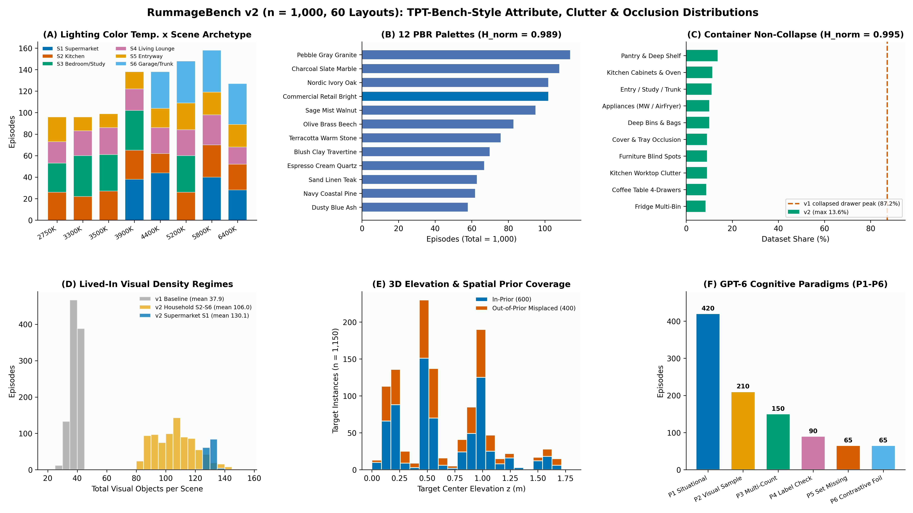
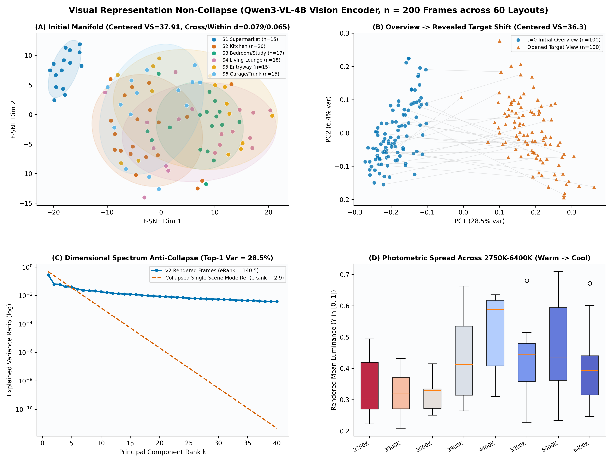
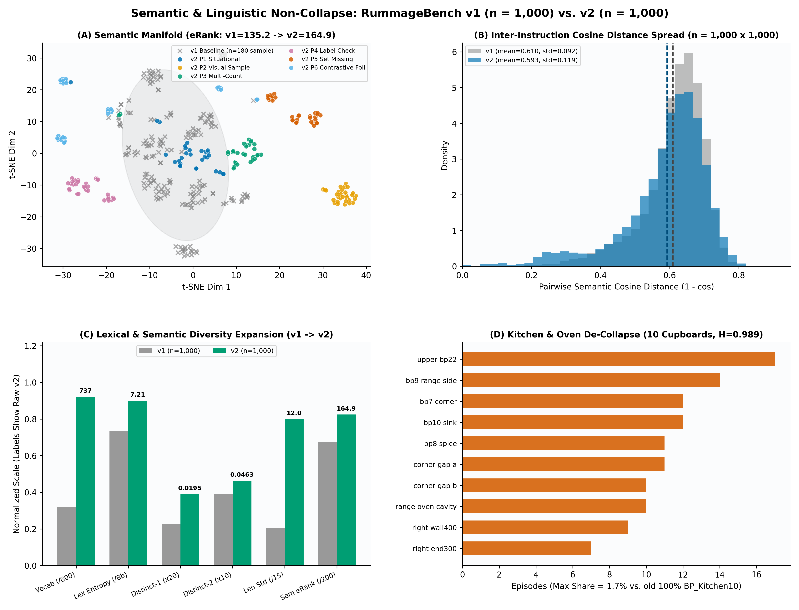
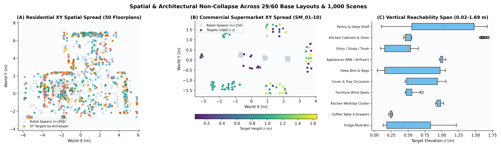

# RummageBench v2: Visual & Semantic Non-Collapse Analysis

> **Positioning (cf. TPT-Bench, arXiv:2505.07446)**: Rather than arguing dataset diversity purely by count, we combine **TPT-Bench-style attribute coverage distributions** (lighting temperature, PBR palettes, clutter density, height, container families, cognitive paradigms) with **USD structural hashing (`scripts/rab_diversity.py`)** and **real `Qwen3-VL-4B-Instruct` visual + semantic representation spectra** (Centered Vendi Score, Effective Rank `eRank`, SVD singular-value decay, t-SNE manifolds, lexical entropy).
>
> Reproducible scripts: [`scripts/rummagebench_v2_extract_embeddings.py`](../scripts/rummagebench_v2_extract_embeddings.py) (CPU ViT + token embeddings) and [`scripts/rummagebench_v2_diversity_vis.py`](../scripts/rummagebench_v2_diversity_vis.py). Full raw metrics & cached embeddings live in `runs/rummagebench_v2_20261124/diversity_report/`.

---

## 1. Structural × Visual × Semantic Summary (`v1` vs. `v2`)

| Audit Axis | Metric | `v1` (`n=1,000`) | **`v2` (`n=1,000`)** | Evidence |
| :--- | :--- | :---: | :---: | :--- |
| **Structural USD** | Base layouts / Unique placement hashes | `50` / `50` | **`60` (`50` home + `10` mart) / `60`** | `29` unique architectural geometry shells |
| **Domain Rand.** | Unique `archetype x layout x light x palette` | Fixed default | **`932 / 1,000`** | `8` lighting temps (`2750K–6400K`) × `12` PBR palettes (`H_norm=0.989`) |
| **Container Priors** | Max family share / Normalized entropy | **`87.2%`** (coffee drawers) | **`13.6%` / `H_norm = 0.9953`** | Spread across `10` container families & `38` search fixtures |
| **Kitchen Cupboards** | Max door share / Normalized entropy | Collapsed to `BP_Kitchen10` | **`1.7%` / `H_norm = 0.9887`** | Uniformly sampled over `10` doors + oven cavity |
| **Visual Spectrum** | `Qwen3-VL-4B` ViT `eRank` (`n=100` / `n=200`) | — | **`78.80`** / **`140.54`** | Slow singular-value tail (`Top-1 = 17.0%` at `n=100`) |
| **Visual Manifold** | Centered Vendi / Cross vs. Within dist | — | **`37.91`** / **`0.0793` vs `0.0651`** | Zero duplicate renders (`max_nn_cos_sim = 0.9785 < 1.0`) |
| **Photometric Span** | Mean luminance `[min, max]` / `R-B` span | Fixed white light | **`[0.2084, 0.7091]`** / **`[0.0161, 0.4699]`** | Smooth warm-to-cool shift across `2750K–6400K` |
| **Lexical Richness** | Vocabulary `|V|` / Entropy `H_lex` | `257` / `5.88 bits` | **`737` (`2.87x`) / `7.21 bits`** | `6` cognitive paradigms (`P1–P6`) + fine-grained target cues |
| **Semantic Manifold** | `Qwen3-VL` Text `eRank` / Len Mean±Std | `135.15` / `22.8 ± 3.11` | **`164.88` (`+22.0%`) / `37.83 ± 12.0`** | `+22.0%` embedding rank expansion; `3.86x` length std |

*(Transparent note: because long-horizon `P2`/`P4`/`P5` protocol prompts share structured framing sentences across episodes, corpus `Self-BLEU-4` stays `0.9427` vs `0.9114` in `v1`; genuine task diversity comes from the 6 cognitive paradigms, 39 distinct target categories, 38 container fixtures, and expanded vocabulary/eRank.)*

---

## 2. Publication Figures

### Fig. 1 — TPT-Bench Style Multi-Attribute & Challenge Distributions

### Fig. 2 — Visual Non-Collapse (`Qwen3-VL-4B-Instruct` ViT Features & Singular Spectrum)

### Fig. 3 — Semantic Non-Collapse (`1,000 v1 vs. 1,000 v2` Embeddings & Cupboard De-Collapse)

### Fig. 4 — 3D Physical Coverage (`850` Residential + `150` Supermarket + Vertical Span)

